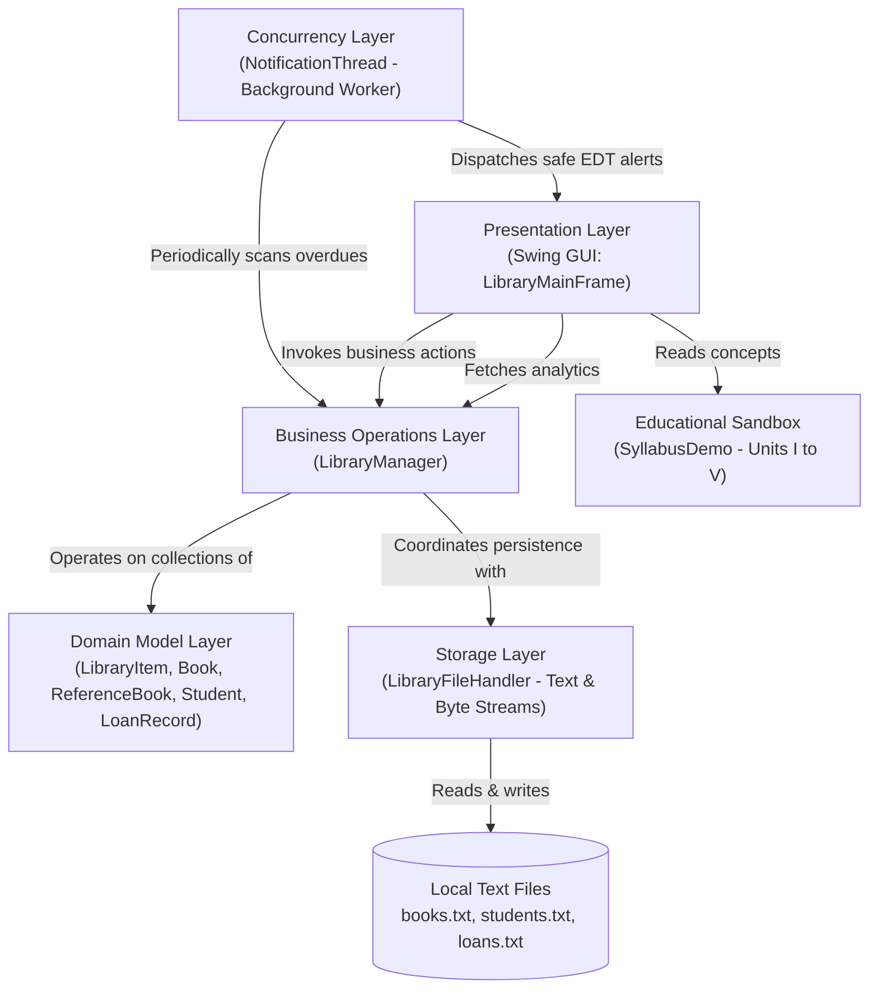
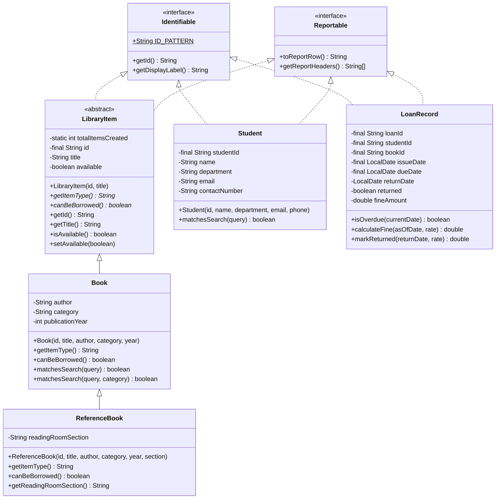
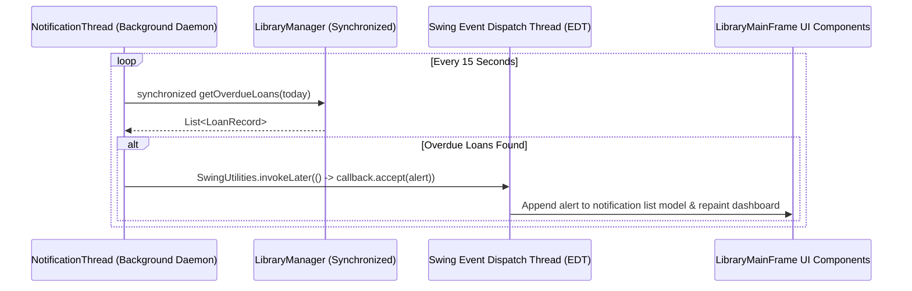

# Project Architecture & System Design Document

**Course:** 24CS202 — Object Oriented Programming Through Java  
**System:** College Library Management System  
**Development Version:** Java 23 (JDK 23)

---

## 1. Architectural Layers Overview

The application follows a clean, decoupled 5-tier architecture tailored for academic clarity and strict separation of concerns:



---

## 2. Object-Oriented Domain Class Hierarchy



---

## 3. Data Integrity & Single Source of Truth

A critical flaw in naive library applications is inconsistent state between loan records and item availability flags. In this system:
1. **Source of Truth for Circulation:** 
   - A book is circulating if and only if an unreturned `LoanRecord` exists where `loan.getBookId().equalsIgnoreCase(book.getId())` and `loan.isReturned() == false`.
   - `activeIssuedBookIds` (`Set<String>`) provides O(1) set-membership validation.
2. **Preventing Concurrent Double-Issue:**
   - `LibraryManager.issueBook(...)` and `returnBook(...)` are `synchronized` methods.
   - When a book is issued, `book.setAvailable(false)` and `activeIssuedBookIds.add(bookId)` happen atomically within the synchronized critical section.
3. **Reference Book Safeguard:**
   - `ReferenceBook` overrides `canBeBorrowed()` to return `false` unconditionally.
   - Any attempt to check out a reference book immediately throws `BookUnavailableException` before any state is mutated.

---

## 4. File Persistence Format Specification

Data is saved in character-delimited UTF-8 text files under `data/`:

### A. `books.txt`
```text
TYPE;ID;TITLE;AUTHOR;CATEGORY;YEAR;AVAILABLE;EXTRA
STANDARD;B-101;Core Java: Fundamentals;Cay S. Horstmann;Computer Science;2024;true;N/A
REF;REF-201;Oxford Advanced Learner's Dictionary;A.S. Hornby;General;2023;true;Reading Room Section R-1
```

### B. `students.txt`
```text
ID;NAME;DEPARTMENT;EMAIL;PHONE
24CS001;Aarav Sharma;CSE;aarav.s@college.edu;9876543210
24CS002;Priya Venkatesh;CSE;priya.v@college.edu;9876543211
```

### C. `loans.txt`
```text
LOAN_ID;STUDENT_ID;BOOK_ID;ISSUE_DATE;DUE_DATE;RETURN_DATE;RETURNED;FINE
LN-1001;24CS001;B-101;2026-10-22;2026-11-05;NULL;false;0.00
LN-1002;24CS002;B-102;2026-10-04;2026-10-18;NULL;false;0.00
```

---

## 5. Concurrency & Swing EDT Model

Swing is single-threaded. Modifying UI elements from worker threads causes intermittent race conditions and visual corruption.


